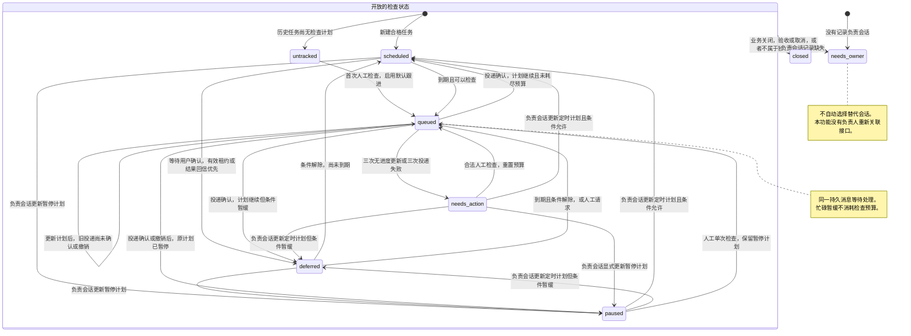

# 任务进度检查

任务插件按计划向任务已记录的负责会话发送检查消息。负责会话核对账本、已有报告和实际工作，再继续处理、记录等待条件或通过正式工具提交结果。同一会话可以自行完成工作，也可以派发子任务。检查不要求固定的调度或执行身份。

检查状态独立于 Task、Run 和 Attempt。检查消息送达、会话空闲或一轮对话结束，都不能证明任务完成。插件不检查其他插件的业务字段，不自动提交成功，不恢复旧执行租约，也不批准执行或重跑结果不确定的操作。

## 自动安排与人工检查

新建任务具有合格的负责会话时，插件自动安排首次检查。`checkinIntervalMs` 默认为 `300000`，即五分钟。省略下一次时间的进度更新，以及未记录进度的自动检查完成后，均使用这个间隔。

历史任务不在升级时自动加入检查。具有合法负责会话的历史任务可以人工触发检查。尚未安排检查的历史任务首次人工检查会启用后续默认自动跟进。观察事项、周期计划容器和独立子任务不另行安排自动检查。子任务由其上级任务的负责会话统一核对。

在任务详情的“负责会话进度”中，点击“检查进度”可请求一次检查。请求使用现有任务操作接口，中央校验任务权限与版本，再决定是否投递。页面不自行选择会话或构造会话消息。已有待处理检查时，重复请求合并为同一项待处理工作。网络结果不确定时，页面重试原命令，不创建第二次检查。

人工检查重置连续无更新与投递失败的计数。已暂停计划的人工检查只执行一次，完成后继续暂停。没有负责会话、受执行租约保护或已经关闭的任务，不能借此创建替代会话或取得新权限。

## 负责会话记录进度

`task_checkin` 提供 `status`、`request` 和 `update` 三个操作。工具从当前会话取得身份，只有账本记录的负责会话可以更新本任务。模型参数不能指定另一位负责人。

读取检查状态或请求检查使用以下参数。

```json
{"action":"status","taskId":"task-id"}
```

```json
{"action":"request","commandId":"check-once-1","taskId":"task-id"}
```

继续工作并安排下一次检查使用完整进度记录。

```json
{
  "action":"update",
  "commandId":"progress-1",
  "taskId":"task-id",
  "observation":"waiting_external",
  "summary":"已核对现有报告，等待外部处理结果。",
  "plan":{"kind":"scheduled","nextCheckAt":"2026-10-27T04:00:00Z"}
}
```

`observation` 可以是 `working`、`waiting_children`、`waiting_external` 或 `blocked`。`summary` 记录负责会话核实的进度。`plan.kind` 为 `scheduled` 时，可以省略 `nextCheckAt` 以使用默认间隔。显式时间必须在将来，且不超过更新时刻的三十天。

等待用户决定或没有可自动推进的条件时，记录原因并暂停。

```json
{
  "action":"update",
  "commandId":"waiting-for-user-1",
  "taskId":"task-id",
  "observation":"blocked",
  "summary":"需要用户确认后才能继续。",
  "plan":{"kind":"paused","reason":"等待用户决定，停止自动检查。"}
}
```

`blocked` 只是负责会话的进度观察。是否继续检查由 `plan` 决定。需要人工处理的阻塞应使用 `paused`，避免反复唤醒。记录 `waiting_children` 也不会让插件无条件等待，插件仍检查子任务是否真的持有有效租约。

进度更新不代替任务最终报告。工作完成后，负责会话使用现有的结果提交工具。自行完成的草稿可以在现有项目与创建会话权限允许时，先调用 `task_bind_dispatcher`，再调用 `task_submit_result`。缺少项目上下文或结果提交能力属于工作流限制，负责会话应记录限制并暂停。已有创建会话仍是真实负责人，不能因此判为负责人缺失。

## 哪些任务会检查

`category` 表示账本中的当前条件，`phase` 表示检查计划与投递状态。两者一起解释检查为何执行或暂缓。

| 类别 | 含义 | 自动检查 | 人工检查 |
|---|---|---|---|
| `closed` | 任务关闭、人工完成或结果已验收，包括已验收的部分结果 | 停止，丢弃尚未投递的过期检查 | 不再唤醒 |
| `not_admitted` | 观察事项、未入选候选、周期计划容器或由上级核对的子任务 | 不另行检查 | 不绕过原有入选与执行流程 |
| `needs_owner` | 任务没有记录负责会话 | 不猜测负责人 | 不创建替代会话 |
| `protected_execution` | 负责人来源带有受管执行租约 | 不恢复该会话的旧租约 | 使用原执行流程或人工核实 |
| `approval` | 等待用户批准执行或审核结果 | 暂缓 | 可核对一次，但不能代替用户批准 |
| `active_execution` | 本任务或其后代有真实、有效的当前执行租约 | 静默暂缓 | 请求保留，等到安全检查时机 |
| `result_pending` | 已有结果回信等待同一负责会话处理 | 结果回信优先，检查暂缓；连续失败达到三次的回信不再无限抑制检查 | 合并等待，不插入竞争对话 |
| `ready` | 没有上述条件，包括未派发草稿、未领取的排队执行、失去有效执行租约的任务或待决定下一步的异常结果 | 到期后检查 | 可立即请求 |

`running` 标签本身不证明执行仍在推进。只有当前 Attempt 与 Run 对应、Attempt 尚未过期且执行处于有效状态时，才进入 `active_execution`。未领取的排队请求和失去有效租约的子任务不能无限抑制负责会话检查。

一次 Run 结束也不总是任务责任结束。未验收的 `partial`、`failed` 或 `blocked` 结果，仍可能需要负责会话判断下一步。结果回信先唤醒，遗漏的后续处理由检查兜底。等待用户审核的结果进入 `approval`；已验收结果与取消结果按关闭规则停止检查。

## 检查阶段与转换

下图展示检查阶段随事件的转换。这些阶段独立于任务的业务状态。`deferred` 是当前条件推导出的暂缓状态，`paused` 是负责会话明确保存的计划。已有检查消息时，即使随后出现忙碌、有效租约或结果回信，阶段仍可显示 `queued`，同时通过 `category` 与 `reason` 说明暂缓原因。



计划与投递按以下规则改变，之后根据当前类别重新计算阶段。进度更新立即保存计划；若旧检查消息仍在途，界面保持 `queued`，直至该投递确认或撤销后才反映新计划。受管执行租约保护的来源显示 `needs_action`，但不提供绕过租约的人工唤醒入口。

| 事件 | 持久记录的变化 | 后续阶段 |
|---|---|---|
| 新建合格任务 | 安排默认时间 | `scheduled` 或因当前条件进入 `deferred` |
| 到期且可以检查 | 写入持久检查消息与关联记录 | `queued` |
| 会话忙碌、已有结果待处理或有效租约 | 保留同一检查，不占用新的检查轮数 | 尚未排队时为 `deferred`，已排队时保持 `queued` |
| 会话完成自动检查，但未显式更新进度 | 连续无更新次数增加，下一次使用默认间隔 | 前两轮重新计算为 `scheduled` 或 `deferred`，第三轮为 `needs_action` |
| 负责会话显式更新进度 | 保存观察与新计划，清除连续无更新及投递失败计数 | 依计划进入 `scheduled`、`deferred` 或 `paused` |
| 负责会话保存暂停计划 | 停止后续自动检查 | `paused` |
| 人工触发合格任务 | 重置检查计数，请求一次检查，保留原计划是否暂停 | `queued`，必要时等待安全时机 |
| 暂停期间的人工检查完成 | 原暂停计划不变 | `paused` |
| 连续三次无法投递或处理检查 | 停止自动重试，保留原因 | `needs_action` |
| 人工检查 `needs_action` 任务 | 清除检查注意项并重置计数 | `queued`，必要时等待安全时机 |
| 任务关闭或当前检查过期 | 取消尚未投递的检查，不执行新的业务操作 | 按最新类别重新计算，已关闭任务为 `closed` |

只有显式进度更新能说明负责会话记录了进度。自动检查对话正常结束，也可能没有执行这个更新，因此不能清除连续无更新计数。第三轮后，界面明确显示需要处理。忙碌暂缓不算投递失败，也不占用无更新轮数。

## 持久投递与权限边界

检查与子任务结果回信复用同一套持久会话投递能力。中央记录事件标识和检查关联，接收端依据持久 inbox 与会话 journal 判断消息是否已经处理。进程重启或确认丢失后继续处理同一个事件，不能重新派发业务任务。

同一负责会话的多项到期任务合并为检查消息。已有检查或结果回信时，插件避免创建竞争对话。投递前重新核对当前任务条件；过期或已关闭的检查不再唤醒。会话当前忙碌时，检查等待其安全处理时机，不打断模型或工具。

原会话的工具、工作区与模型权限仍然有效。检查不会扩展工具能力，也不复活失效的执行租约。复用现有代理时，若其模型配置与保存的负责会话配置不一致，投递明确报告不匹配，不静默覆盖当前模型。当前结果提交能力不足、外部业务未完成与检查消息无法投递是不同的问题。负责会话通过进度观察记录前两类工作流限制，插件通过检查阶段显示后一类投递问题。

任务详情将没有 Run 的草稿显示为“未派发”。只有实际已创建并等待领取的执行请求显示“等待开始”，避免把草稿误当成执行队列。
