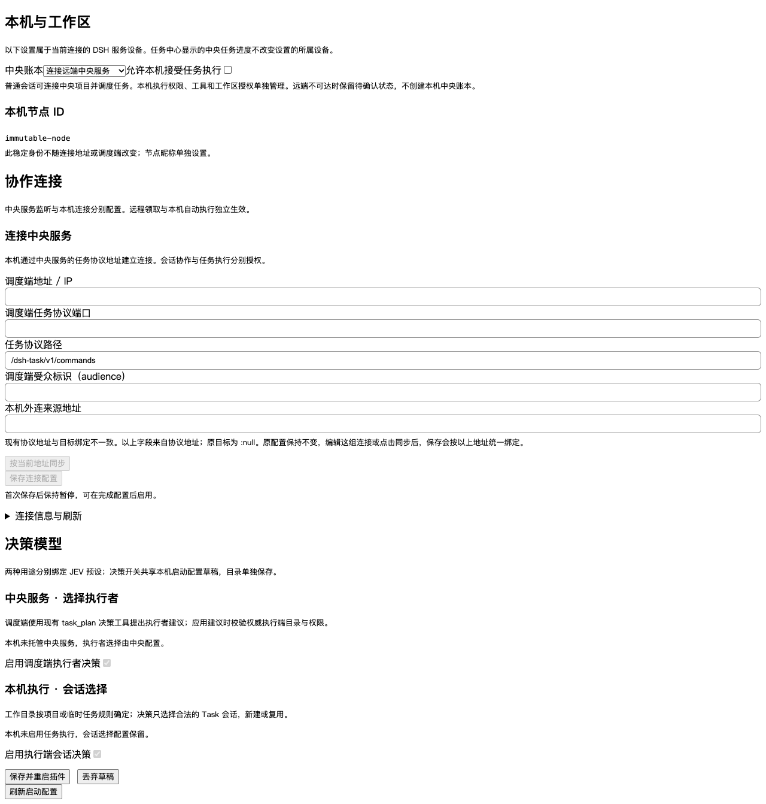

# Verification evidence

The final feature source passed local checks, isolated installed-package acceptance, and real browser checks. This is development evidence on macOS with Node v26.5.1. Linux/Node 24 PR gates and fixed-candidate release acceptance remain separate requirements.

## Commands and results

All commands ran from `/private/tmp/dsh-session-duty-authority`, with `/opt/homebrew/bin` first on PATH. Native and distribution checks used the isolated official DSH and dsh-web-app 0.2.1-rc.2 runtime at `/private/tmp/dsh-ci-current-requirements/.runtime/official-dsh-0.2.1-rc.2`, selected through `DSH_CI_RUNTIME_ROOT` and `DSH_OFFICIAL_ROOT`. No personal runtime or production data was used.

- `npm run check`: exit 0; build, fixtures and all eight suite groups passed.
- `DSH_CI_RESULTS_DIR=/private/tmp/session-duty-handoff-results npm run test:distribution`: exit 0; all 10 task-system installation stages and all 9 capability stages passed.
- `DSH_BROWSER_OUTPUT=/private/tmp/session-duty-browser npm run test:browser`: exit 0; settings, executor alerts and task-center polling/selection passed.
- `git diff --check`: clean before handoff.

| Suite | Tests | Passed | Skipped |
| --- | ---: | ---: | ---: |
| core | 498 | 497 | 1 |
| native | 196 | 196 | 0 |
| ui | 186 | 186 | 0 |
| official | 44 | 44 | 0 |
| jev | 67 | 67 | 0 |
| dashboard | 52 | 52 | 0 |
| task-pack | 106 | 106 | 0 |
| management | 26 | 22 | 4 |

Total: 1,175 tests, 1,170 passed, 5 skipped, zero failures or cancellations. The core skip is the source-IP integration case requiring a 127.0.0.2 loopback alias unavailable by default on macOS; verifier-level denial tests remain active. Four management cases require externally supplied private fixtures. No fixture was fabricated to replace them.

The final task-system tarball is `dsh-task-task-system-0.2.51.tgz`, SHA256 `01500ef1d59765e01287b5aa56fd501bc74e7485c6d2515ae7dcd106a4ffbe38`. Distribution and capability receipts agree on those package bytes. Fresh receipts were used after the final source change; earlier receipts are superseded. This local package is not the previously deployed 0.2.51 package and has not been installed on production devices.

[verification.json](verification.json) preserves sanitized suite counts, stage results and package checksums. Raw local logs remain at `/private/tmp/session-duty-check.log`, `/private/tmp/session-duty-distribution.log` and `/private/tmp/session-duty-browser.log`. Raw receipts remain in `/private/tmp/session-duty-handoff-results`; browser group details remain in `/private/tmp/session-duty-browser/results.json`.

## Behavior exercised

The new native tests run real isolated Loader/AgentLoop hosts, SQLite ledgers, signed HTTP and trusted-network HTTP. They register scheduling-only remote devices without execution claims, attach projects whose directories do not exist on central, bind parent coordination Runs, dispatch children, query/wait central state, recover after central downtime, return into the original session after restart, and settle the parent. They reject cross-project reads and cross-node controls, exercise cancel/status through the remote UI path, and assert that remote devices never mount a local management authority or worker. The external model is scripted.

Core regressions cover attaching an existing empty-backlog project, exact result replay after loss of the outer receipt, closed command schemas, redacted scoped history, completion selection ahead of retained ordinary messages, configuration-edit admission during return processing, and host-managed workspace authorization. Existing schedules/workflows, unprojected task, daily-reader and artifact restrictions remain covered by the current suites. No live daily-source configuration was collected or migrated.

Browser checks exercise the real React settings lifecycle and separate central-mode/execution controls. This synthetic screenshot records remote central mode with execution disabled:

## Independent review

Two independent GPT-6.1-Sol reviewers at high reasoning inspected the implementation: authority/session/return behavior, and configuration/transport/UI behavior. Both ended VERIFIED with no remaining findings. Accepted findings were fixed before the final checks:

- Preserve central project IDs when attaching projects without a backlog, and preserve exact committed result retries.
- Reject invalid narrow commands, scope history and redact raw configuration/context/artifact paths.
- Select completion messages before queue limits and include return continuations in configuration admission.
- Preserve legacy execution grants only for fully legacy configuration; new/mixed fields require explicit execution enablement while an old executor keeps remote authority.
- Pair scheduling-only trusted peers before any execution heartbeat; round-trip peer execution permissions and avoid empty-monitor failures.
- Keep local/central navigation available after cold central failure, and retain trusted host-managed selected-workspace checks.

Reviewers independently verified affected regressions, including the final selected-workspace and mixed-policy fixes. A scoped comment-quality pass found no actionable comment issue.

## Delivery boundary

The branch starts at verified `origin/dev` `7ca2d01c23aa43c01f552ceddf21f3fcc8ca7309`. Baseline main and deployed-device evidence is recorded in [plan.md](plan.md). The primary checkout stays on `main` `f318fcb4f8513720a1366351ddd5f7dc6e30727d`; its ten pre-existing tracked `.scratch/pstack/dashboard-feedback` deletions remain untouched.

Package versions and lockfiles are unchanged. This work does not change runtime model defaults, production state, release refs, or tags. The coordinator owns pushing the branch, creating the development PR and checking its Linux gates. Before any release, follow [DEVELOPMENT.md](../../DEVELOPMENT.md), retain the exact full-CI tarballs, complete real AWS/MBP acceptance and obtain explicit user confirmation.
